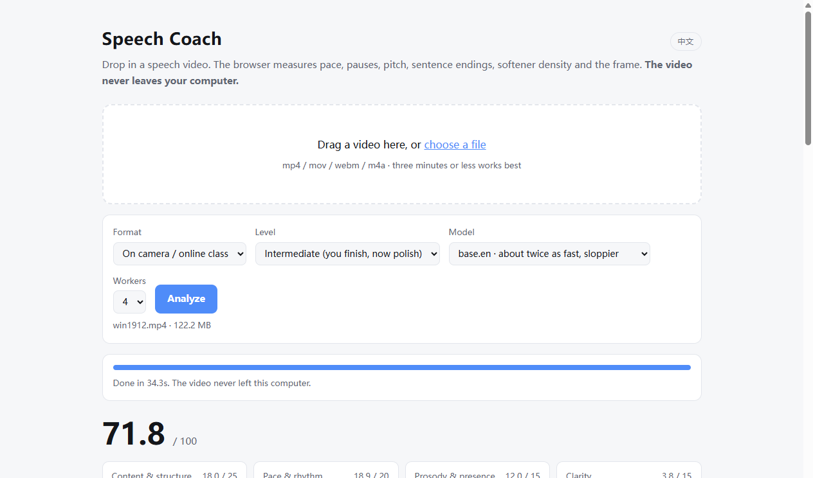

# Speech Coach

**Drop in a video of a talk. Get a score from 0 to 100 and a short list of what to fix first.**

Everything runs inside your browser. The video never leaves your computer — no upload, no server, no account, no API key.

**[Open it online](https://chxjames.github.io/speech-coach/)** · [中文说明](README.zh.md) · [How the scoring works](SCORING.md)

Two ways in, one engine:

| | What it is | Who it is for |
|---|---|---|
| **Web app** (`docs/`) | The page above. Drop a file, get a score. Nothing is uploaded. | Anyone, on a laptop or a phone |
| **MCP server** (`mcp/`) | A tool for Claude Code, Codex and other MCP clients, so an agent can score a video for you | People who live in a terminal |



The interface switches between English and Chinese with the button in the top-right corner; the choice is remembered.

## Why this exists

Feedback on a talk is usually either "you did great" from a friend, or an hour with a coach you see once.
Most of what a coach first notices, though, is measurable: how fast you speak, where you pause, whether your
pitch moves, whether every sentence ends the same way, how many filler words you use, how much of the frame
you actually use.

This tool measures those, scores them against published speech research, and then tells you the **two or
three things** that would win back the most points — instead of a 40-item list nobody acts on.

## What you get

- **A score out of 100** across six dimensions, weighted for your format (webcam vs. stage).
- **A findings list ordered by points lost** — the top item is the one to work on this week.
- **A sentence-by-sentence table**: text, pitch range, sentence-final contour, loudness, speaking rate.
- **The full transcript**, so you can check what you actually said.
- **A downloadable Markdown report** you can keep and compare against the next take.

## Quick start

**Online** — open <https://chxjames.github.io/speech-coach/>, drag your video onto the page, wait.
The first run downloads the speech model (40–250 MB depending on the one you pick); the browser caches it, so
the second run starts immediately.

**Locally** — it is a static site with no build step:

```sh
cd speech-coach
python -m http.server 8792
# open http://127.0.0.1:8792/
```

Opening `index.html` by double-clicking will **not** work: under `file://` the browser refuses to start the
Web Workers that do the transcription. Use the local server (or the hosted page).

The interface is in Chinese; the report, this README and `SCORING.md` are bilingual.

## What it measures

| Dimension | Webcam | Stage | How it is obtained |
|---|---:|---:|---|
| Content & structure | 25 | 25 | **Manual** — your judgement, via a slider |
| Pace & rhythm | 20 | 20 | Net speaking rate + average pause length |
| Pitch & expressiveness | 15 | 20 | Pitch range, sentence-to-sentence variation, sentence-final rise/fall |
| Clarity | 15 | 15 | Articulation rate + softener density (`like`, `just`, `actually`, …) |
| Body language | 5 | 15 | How much the picture moves (automatic, coarse) |
| Production & framing | 20 | 5 | Resolution, bitrate, exposure (automatic) + **manual** framing slider |

Pick **webcam** when you are talking into a camera, **stage** when you are standing at a podium: the same
measurements are reweighted, because a room-filling talk leans on the voice and the body, while a laptop video
leans on framing and sound quality.

The automatic part cannot tell whether what you said was worth saying. That is why content is a slider, not a
guess: the tool is a mirror, not a judge.

## Levels

The same measurements, scored against three different sets of targets, so a first talk is not judged by
competition standards:

| Level | Who it is for | Main difference |
|---|---|---|
| 入门 Starter | first time on stage | slower pace accepted, shorter pitch range accepted, more fillers accepted |
| 进阶 Solid | you can finish a talk and want to do it well | the default |
| 专业 Pro | competition, pitch, conference | wider pitch range required, shorter pauses required, near-zero fillers |

## Scenes

A 3-minute contest talk and a job interview are not judged the same way, so the tool also asks **what the
talk is for**. The scene multiplies the six weights and overrides the targets that matter in that room:

| Scene | Leans on | Overrides |
|---|---|---|
| Class assignment | clarity, body | slower pace, longer sentences forgiven, fillers forgiven |
| Final presentation | content | shorter sentences, fewer fillers |
| Competition (3MT-style) | expressiveness, body | calibrated on 12 3MT winners: 160 wpm, 0.70 s pauses, 10 s max sentence, 9.5-semitone range |
| Job interview | clarity | 8 s max sentence, 0.8 fillers per 100 words — brevity over flourish |
| Thesis defence | content ×1.35 | slower is fine (145 wpm), terminology allowed |
| Pitch / demo | expressiveness ×1.2 | 0.60 s pauses, wide pitch range, almost no fillers |

Scene, level and format are independent: **format** sets the base weights, **scene** bends them and moves
the targets, **level** sets how forgiving those targets are.

Every formula, the target values, and the paper or dataset each value comes from (Foulke 1968,
Goldman-Eisler 1968, Laver 1994, Aoyama 2016, Tielen 1989, …) are in [SCORING.md](SCORING.md). That file also lists, honestly,
the values that are my own estimates rather than published figures.

## How it works

```
video ──► decode audio (Web Audio) ──► mono 16 kHz ──► 30 s chunks
                                                        │
                                    N Whisper Workers (WASM, int8) in parallel
                                                        │
                              word-level timestamps ◄───┘
                                        │
        pitch (autocorrelation 60–400 Hz), sentence split on 0.45 s gaps,
        pauses, fillers, rate ──────────┤
                                        │
        video: 24 sampled frames → resolution, bitrate, exposure, motion
                                        │
                                    scoring ──► score card + findings + report
```

No GPU, no server: `transformers.js` runs Whisper through ONNX Runtime WebAssembly, four workers cover the
four chunks, and each worker returns word-level timestamps that are stitched back together in order.

## Accuracy and limits

- **The transcript is a tool, not a transcript.** Small local Whisper models mishear accented, fast or quiet
  speech. Check the sentence table before you trust a number derived from it.
- **Do not compare rate numbers across models.** `base.en` hears roughly 7 % more words than `large-v3` on the
  same clip, so articulation rate comes out about 10 % higher. Compare two takes made with the same model.
- **Content and framing are your own scores.** The tool cannot judge an argument.
- **Body language is coarse.** It measures how much the picture moves; it cannot see a nervous tic.
- **Long videos** (over roughly 20 minutes) can exhaust browser memory while the audio is decoded.
- **Accents**: the `.en` models are trained mostly on clear American English. For other English accents the
  transcript degrades; the prosody numbers survive better than the words.

## Privacy

- The video is read with `URL.createObjectURL` and decoded locally. It is never uploaded.
- There is no analytics, no tracking, no account, no cookie.
- The only network requests are the static files of the site and the model weights from the Hugging Face CDN.
- Nothing is stored server-side; the model cache lives in your browser's cache.

## Performance (measured, not estimated)

A 125-second 720p recording, 4 workers, on a laptop (Chromium, WebAssembly):

| Model | Time | Notes |
|---|---|---|
| `whisper-tiny.en` | 23 s | fast, visibly less accurate |
| `whisper-base.en` | 31–35 s | the everyday choice |
| `whisper-small.en` | 92 s | better on accented speech; 118 s on the first run, while the 250 MB of weights download |

The clock covers decode, transcription and scoring. Model weights are the only thing that has to be fetched
once — after that runs take the time in the table.

GitHub Pages cannot send `Cross-Origin-Opener-Policy` / `Cross-Origin-Embedder-Policy`, so
`SharedArrayBuffer` is unavailable and each worker runs single-threaded. I expected that to hurt — it does
not:

| Setup | Time on the same clip |
|---|---|
| No COOP/COEP headers (GitHub Pages) | 30.8 s / 31.1 s / 33.0 s |
| With COOP/COEP, `crossOriginIsolated = true` | 37.3 s / 43.1 s |

Adding the headers made it **slower**: each of the four workers started its own thread pool and they competed
for the same cores. Worker-level parallelism already saturates the machine. `serve_isolated.py` is kept in the
repository if you want to re-measure this on your own hardware.

## Models

| Model | Size | When |
|---|---|---|
| `Xenova/whisper-tiny.en` | ~40 MB | quick look, or a slow machine |
| `Xenova/whisper-base.en` | ~80 MB | default on phones |
| `Xenova/whisper-small.en` | ~250 MB | default on desktop; best accuracy of the three |

Models are fetched from the Hugging Face CDN on first use and cached by the browser.

## Deploy your own copy

1. Fork or push this repository to GitHub.
2. **Settings → Pages → Source: Deploy from a branch**, branch `main`, folder **`/docs`**.
3. Open `https://<user>.github.io/<repo>/`.

`docs/.nojekyll` is already present, so the `docs/js/` folder is served as-is.

## Project layout

```
docs/
  index.html          page shell
  app.css             styles (light/dark, mobile)
  js/audio.js         decode any video → mono 16 kHz, chunking
  js/asr-worker.js    one Whisper worker (WASM, int8)
  js/asr.js           worker pool, ordered merge, duplicate-word cleanup
  js/prosody.js       pitch tracking, sentence split, pauses, fillers, rates
  js/video.js         resolution, bitrate, exposure, motion
  js/score.js         the six dimensions, weights, scenes, levels  ← change targets here
  js/i18n.js          English / Chinese strings
  js/report.js        Markdown report
  js/app.js           wiring
  serve_isolated.py   local server that sends COOP/COEP, for re-measuring
mcp/
  src/server.js       MCP server, the `analyze_speech` tool
  src/*.js            the same engine, run by Node instead of the browser
README.md             this file
SCORING.md            every formula and its source
```

## License

MIT — see [LICENSE](LICENSE).
