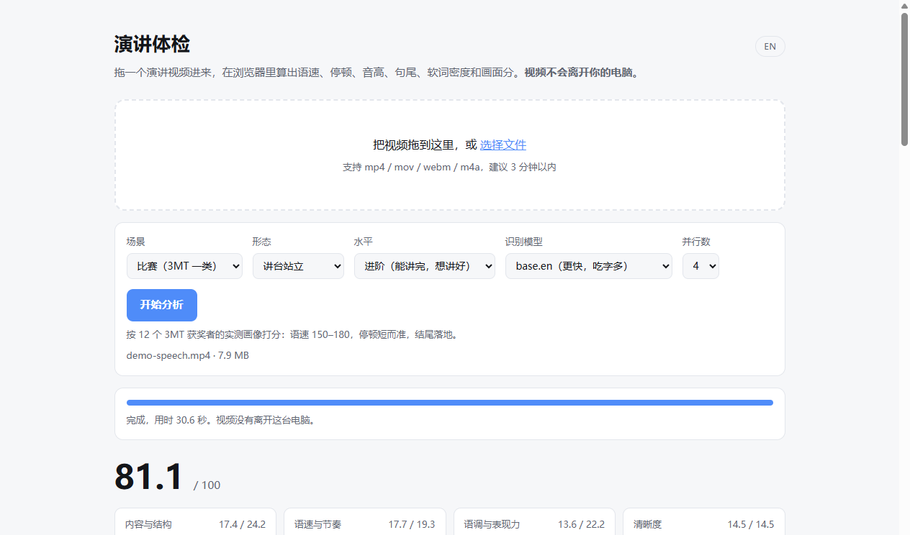

# 演讲体检 · Speech Coach

**把一段演讲视频拖进网页，得到一个 0–100 的分数，和一份"先改这几处"的清单。**

全部在你的浏览器里跑。视频不会离开你的电脑——不上传、没有服务器、不用注册、不需要 API key。

**[在线直接用](https://chxjames.github.io/speech-coach/)** · [English](README.md) · [评分方法](SCORING.md)

两种用法，同一套引擎：

| | 是什么 | 给谁用 |
|---|---|---|
| **网页版**（`web/`） | 就是上面那个页面。拖一个文件进去，出分数，什么都不上传。 | 任何人，电脑或手机都行 |
| **MCP server**（`mcp/`） | 给 Claude Code、Codex 这类 MCP 客户端用的工具，让 agent 帮你分析视频 | 习惯在终端里干活的人 |



右上角的按钮可以在中文和英文之间切换，选择会被记住。

## 为什么做这个

一场演讲得到的反馈，通常要么是朋友一句"挺好的"，要么是约一次就再也约不上的教练。
但教练第一眼看到的东西，大部分是可以量的：说得多快、在哪里停、音高有没有起伏、是不是每句都用同一个调收尾、
填充词用了多少、画面用满了没有。

这个工具把这些量出来，按公开发表的语音研究打分，然后只告诉你**最该改的两三件事**——
而不是一张四十条、谁也不会动手的清单。

## 你会拿到什么

- **一个 100 分制的总分**，分六个维度，权重按你的形态算（对镜头 / 讲台）。
- **按丢分排序的问题清单**——排第一的就是这周该练的。
- **逐句表**：文本、音域、句尾升降、音量、语速。
- **完整文字稿**，方便核对当时到底说了什么。
- **可下载的 Markdown 报告**，留下来和下一次对比。

## 怎么开始

**在线用**——打开 <https://chxjames.github.io/speech-coach/>，把视频拖进去，等一会。
第一次会下载识别模型（按你选的模型 40–250 MB），浏览器会缓存，第二次就快了。

**本地跑**——纯静态网页，没有编译步骤：

```sh
cd speech-coach
python -m http.server 8792
# 打开 http://127.0.0.1:8792/
```

**直接双击 `index.html` 不行**：`file://` 协议下浏览器不肯启动做转写的 Web Worker。要么起本地服务，要么用线上地址。

## 它会看什么

| 维度 | 对镜头 | 讲台 | 怎么来的 |
|---|---:|---:|---|
| 内容与结构 | 25 | 25 | **人工打分**（滑杆） |
| 语速与节奏 | 20 | 20 | 净语速 + 平均停顿长度 |
| 语调与表现力 | 15 | 20 | 音域 + 句间起伏 + 句尾升降 |
| 清晰度 | 15 | 15 | 发音速率 + 软化词密度（like / just / actually …） |
| 身体语言 | 5 | 15 | 画面动作幅度（自动，颗粒度粗） |
| 制作与镜头 | 20 | 5 | 分辨率、码率、曝光（自动）+ **构图滑杆**（人工） |

坐着对着摄像头讲，选**对镜头**；站在台上讲，选**讲台**。指标是同一批，权重重算——
因为面对全场时胜负在声音和身体，面对笔记本电脑时胜负在构图和声音质量。

自动部分看不出你讲的东西值不值得讲，所以"内容"是滑杆，不是猜的。这个工具是镜子，不是裁判。

## 三档水平

同一批指标，三套目标值，免得第一次上台的人被拿比赛标准砍：

| 水平 | 给谁 | 主要差别 |
|---|---|---|
| 入门 | 第一次上台 | 容许多一点慢、音域窄一点、填充词多一点 |
| 进阶 | 能讲完，想讲好 | 默认这一档 |
| 专业 | 比赛、路演、大会 | 要求更宽的音域、更长的停顿、几乎不许有填充词 |

默认是"比赛 + 进阶"。换场景或水平，同一段录像的分数会明显不同——这正是设计的意图，
所以这里不给一个固定的"标准分"。
每个公式、每个目标值、以及它出自哪篇文献（Foulke 1968、Goldman-Eisler 1968、Laver 1994、Aoyama 2016、Tielen 1989……）
都写在 [SCORING.md](SCORING.md) 里。那份文件也老实列了哪些数是**我自己的经验值**，没有文献可引。

## 六种场景

同样是三分钟，比赛和工作面试不该用一把尺子。所以工具还会问**这场讲给谁、为什么讲**。
场景会调整六个维度的权重，并覆盖这个场合真正看重的目标值：

| 场景 | 更看重 | 覆盖的目标值 |
|---|---|---|
| 课堂作业 / 练习 | 清晰度、身体 | 语速慢一点也行、长句和填充词都宽容 |
| 期末展示 / 汇报 | 内容 | 句子要短、填充词要少 |
| 比赛（3MT 一类） | 语调、身体 | 按 12 个 3MT 获奖者标定：160 wpm、停顿 0.70 s、最长句 10 s、音域 9.5 半音 |
| 面试 / 求职 | 清晰度 | 最长句 8 s、填充词 0.8/100 词——宁可短，别啰嗦 |
| 答辩 / 评审 | 内容 ×1.35 | 语速 145 也正常，术语可以留着 |
| 路演 / 推销 | 语调 ×1.2 | 停顿 0.60 s、音域要宽、几乎不许有多余词 |

形态、场景、水平是三个独立的旋钮：**形态**定基础权重，**场景**在此基础上调整并换目标值，
**水平**决定这套目标值有多宽容。

## 它是怎么算的

```
视频 ──► 解码音轨（Web Audio）──► 单声道 16 kHz ──► 切 30 秒一块
                                                        │
                                     N 个 Whisper Worker（WASM，int8）并行
                                                        │
                              词级时间戳 ◄──────────────┘
                                        │
        音高（自相关 60–400 Hz）、按 0.45 秒空隙切句、停顿、填充词、语速 ──┤
                                        │
        画面：抽 24 帧 → 分辨率、码率、曝光、动作幅度 ────────────────────┤
                                        │
                                    打分 ──► 评分卡 + 问题清单 + 报告
```

没有 GPU，没有服务器：`transformers.js` 用 ONNX Runtime WebAssembly 跑 Whisper，四个 Worker 并行处理，
每个 Worker 返回词级时间戳，再按顺序拼回去。

## 准确率和限制

- **文字稿是工具，不是圣旨。** 本地小模型对口音、快语速、小声的句子会听错，用逐句表之前先自己扫一眼。
- **不同模型之间的语速数字不能比。** 同一段音频，`base.en` 比 `large-v3` 大约多听 7% 的词，发音速率因此虚高约 10%。
  要比就比同模型下的两次录像。
- **内容与构图是你自己打的分。** 工具判断不了论点站不站得住。
- **身体语言很粗。** 它只量画面动得多不多，看不见你紧张时的小动作。
- **很长的视频**（大约 20 分钟以上）在解码音频时可能吃掉浏览器内存。
- **口音**：`.en` 模型主要训练于清晰的美国英语，别的口音文字稿会掉得更多；韵律数字比文字更抗口音。

## 隐私

- 视频用 `URL.createObjectURL` 读入、本地解码，**不上传**。
- 没有统计代码、没有追踪、不用注册、不写 cookie。
- 唯一的网络请求是站点自己的静态文件，和从 Hugging Face CDN 下载的模型权重。
- 服务器端不存任何东西；模型缓存留在你自己的浏览器里。

## 速度（实测，不是估计）

125 秒 720p 录像、4 个 Worker、一台笔记本（Chromium，WebAssembly）：

| 模型 | 用时 | 说明 |
|---|---|---|
| `whisper-tiny.en` | 23 秒 | 快，但听得明显差 |
| `whisper-base.en` | 31–35 秒 | 日常用 |
| `whisper-small.en` | 92 秒 | 口音重时更准；第一次跑 118 秒（含 250 MB 权重下载） |

表里的秒数包含解码、转写和打分。只有模型权重需要联网取一次，之后就是表里的速度。

GitHub Pages 不能自定义 `Cross-Origin-Opener-Policy` / `Cross-Origin-Embedder-Policy` 响应头，
所以用不了 `SharedArrayBuffer`，每个 Worker 内部是单线程的。我本以为这会是大损失——**实测并不是**：

| 配置 | 同一段视频用时 |
|---|---|
| 不加 COOP/COEP（= GitHub Pages） | 30.8 秒 / 31.1 秒 / 33.0 秒 |
| 加 COOP/COEP，`crossOriginIsolated = true` | 37.3 秒 / 43.1 秒 |

**加了头反而更慢**：4 个 Worker 各自又开了一套线程池，互相抢核心。Worker 层面的并行已经把机器用满了。
`serve_isolated.py` 留在仓库里，想在你自己的机器上复测随时能跑。

## 模型怎么选

| 模型 | 大小 | 什么时候用 |
|---|---|---|
| `Xenova/whisper-tiny.en` | 约 40 MB | 先看看效果，或机器很慢 |
| `Xenova/whisper-base.en` | 约 80 MB | 手机上默认 |
| `Xenova/whisper-small.en` | 约 250 MB | 电脑上默认，三者里最准 |

模型第一次使用时从 Hugging Face CDN 下载，之后浏览器缓存。

## 部署一份自己的

1. 把这个仓库推到（或 fork 成）你自己的 GitHub 仓库。
2. **Settings → Pages → Source 选 Deploy from a branch**，分支 `main`，目录 **`/web`**。
3. 打开 `https://<用户名>.github.io/<仓库名>/`。

`web/.nojekyll` 已经在了，`web/js/` 目录会原样发布。

## 文件结构

```
web/
  index.html        页面骨架
  app.css           样式（深浅色自适应、手机布局）
  js/audio.js       解码任意视频 → 单声道 16 kHz、分块
  js/asr-worker.js  一个 Whisper Worker（WASM，int8）
  js/asr.js         Worker 池、按序合并、去掉接缝重复词
  js/prosody.js     音高跟踪、切句、停顿、填充词、语速
  js/video.js       分辨率、码率、曝光、动作幅度
  js/score.js       六个维度、权重、场景、三档水平  ← 改目标值改这里
  js/i18n.js        中英文案
  js/report.js      Markdown 报告
  js/app.js         串起来
  serve_isolated.py 带 COOP/COEP 的本地服务器，用于复测
mcp/
  src/server.js     MCP server，`analyze_speech` 工具
  src/*.js          同一套引擎，用 Node 跑而不是浏览器
README.md           本文件
SCORING.md          全部公式与出处
```

## 协议

MIT，见 [LICENSE](LICENSE)。
